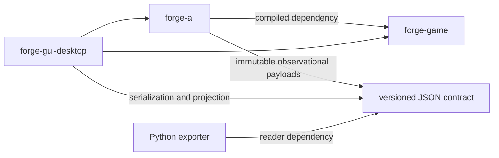

# HARD-001: decision-tracing coupling assessment

Assessment date: 2026-11-18. Production baseline: `f2bc148cecf6bae1a499889a8a02551c0f24509e` on `goldfish-trace`. **Complete: retain the architecture and version-1 wire format, with targeted correctness, lifetime, and exporter follow-ups.** This assessment does not declare those follow-ups fixed. No production behavior or schemas were changed for this review.

The findings and measurements below describe that baseline. Subsequent fixes are tracked in [the implementation follow-up](#implementation-follow-up-2026-11-18); historical evidence is preserved.

## Decision

The dependency on *live execution identity and delivery timing* has demonstrated costs. A real Necrotic Ooze activation loses its decision link because an existing engine accessor returns a transitive original rather than the selected intermediate ability. Some scalar correlations and pending ability aliases outlive their useful execution scope. Those are concrete reasons to harden the boundary before expanding instrumentation.

Repeated wire IDs are a smaller issue in this corpus. A deletion-only counterfactual saves 1.25–1.74% of complete raw streams, while removing standalone diagnostics and independent identity checks. Keep these fields. The exporter has separate, measured memory and validation-scaling problems; schema normalization is not needed to address them.

Do not move file output into AI, make rules depend on the learning schema, introduce an assumed global action token, or rewrite the event system as an assessment outcome. Fix the established contracts in separate commits. Consider immutable commit-boundary metadata if reentrant/asynchronous delivery or broader live snapshots become a requirement.

## Dependency direction and ownership

There is no new reverse compiled dependency from `forge-game` to the collector/exporter. The runtime graph is more coupled than the module graph:

| Owner | Responsibility and dependency | Retained state |
| --- | --- | --- |
| `Game` | Recording gate, decision sequence, generic EventBus | Subscribers for the lifetime of the Game; no public unsubscribe API |
| `AiDecisionRecorder` | Reads partial player state, candidate assessments and selected abilities | Viewer Player plus one decision's JSON graph; worker writes and closing are synchronized |
| `AiController` / `AiActionTracker` | Publish selection, bracket execution, follow explicit casting aliases, observe stack insertion | One per-controller tracker; pending/started attempts strongly reference selected/transformed abilities until retired |
| `PlayerControllerAi` / `ComputerUtil` | Execution outcome and explicit transformation aliases | Existing engine execution objects; no output sink |
| `SimulationTraceCollector` | Translate events, look up active AI selection, correlate later stack events | Game, sinks, scalar ability/stack/action maps, completed-stack set, and a separate scalar pending-selection ledger |
| Snapshot adapters | Read live committed stack/target/mode/payment objects | Temporary callback references; returned graphs contain JSON values, not engine objects |
| `SimulationTraceRun` / writer | Run provenance, participant mapping, counters, output and final markers | Run stores no list of completed collectors; writer streams to a buffered sink rather than retaining rows |
| Python exporter | Validate relationships, construct rows, outcomes, examples and reports | All loaded run/game/decision/action graphs, dataset rows, and a whole serialized dataset string during output |

The collector's direct path is `actual ability → activating player → PlayerControllerAi → AiController → tracker`. After a successful lookup, it retains only a pair of strings by stack ID. The tracker, unlike those scalar maps, retains live abilities while an attempt is pending/started. IDs on the wire do not themselves retain engine objects.

Source anchors: [tracker](../../forge-ai/src/main/java/forge/ai/AiActionTracker.java), [recorder](../../forge-ai/src/main/java/forge/ai/AiDecisionRecorder.java), [controller hooks](../../forge-ai/src/main/java/forge/ai/PlayerControllerAi.java), [collector](../../forge-gui-desktop/src/main/java/forge/view/SimulationTraceCollector.java), [run owner](../../forge-gui-desktop/src/main/java/forge/view/SimulationTraceRun.java), [writer](../../forge-gui-desktop/src/main/java/forge/view/SimulationTraceWriter.java), [exporter](../../tools/decision-records/export.py).

## Timing, dispatch and lock contracts

On the normal priority path, selection registers aliases before publishing the decision; execution marks an attempt started before mutation/payment; the engine adds the stack item before posting the cast event. The collector queries active aliases independently of the tracker's cast subscriber, so those two subscribers' relative order is not significant in this path.

Guava 33.3.1-android uses a direct executor with a **per-thread queued dispatcher**. A top-level event is delivered before its post returns. An event posted from inside a subscriber is queued until that outer subscriber returns. Therefore “same-thread EventBus” is not a general guarantee that aliases or live stack entries still exist when a callback runs.

Tracker methods hold their monitor while posting observational events. The three collector subscriber methods have separate Guava subscriber locks but share `eventIndex`, error state and ledgers. The normal game-worker path is serialized; cancellation can post outcomes from another thread. Writer synchronization prevents partial-line interleaving per sink, not a shared event-index transaction. No deadlock or real CLI index race was reproduced. A blanket collector lock could create an inversion with tracker-held event delivery and collector-to-tracker lookups; it is not a safe default fix.

`GAME_OUTCOME` / `GAME_FINISHED` can precede late selection or execution during cancellation. Final retirement belongs after game-worker termination and pending final records, not at the early game announcement. A separately cancelled AI evaluation worker can outlive that worker boundary. Future retirement must prevent late intake from recreating state, release aliases independently of collector locks, and run even when the sink is unhealthy.

## Reproduced identity and failure defects

| Fixture | Observed result | Interpretation |
| --- | --- | --- |
| Ordinary Archivist activation | Selected ability 4 → actual 6, stack 1; linked `SUCCEEDED/STACKED` | Positive control |
| Necrotic Ooze granted Archivist's ability | Selected 13 → original template 11; actual 14, stack 2; full addition has null action reference, filtered addition absent, terminal `UNOBSERVED` | Real rules interaction exposes a trace correlation defect; the activation reaches the stack |
| Archivist played from a test EventBus subscriber | Selected 19 → actual 21, stack 3; same loss of linkage | Demonstrates a reentrancy boundary assumption; no normal CLI caller using this pattern was identified |
| Injected worker exception after a deterministic recorded selection | Both outputs preserve start, decision, outcome, abandonment, EXCEPTION execution/run markers; neither emits `GAME_FINISHED`; exporter rejects both | Producer/consumer failure-boundary contract mismatch |

The ordinary and Ooze fixtures use real card scripts and the normal execution path. `MagicStack` copies an activated ability and points it at its immediate predecessor, but `SpellAbility.getOriginalAbility()` returns the deepest original. Matching only actual or deepest-original identity misses the selected grant. Matching every ability that shares a lineage root would weaken attribution; preserve the execution-specific predecessor instead. The exception fixture manually emits a start and a deterministic recorded selection from its overridden `Match.startGame`, then injects the failure through the production worker/catch/finalization path; it does not demonstrate a natural AI selection or a spontaneous ordinary-game crash.

The reentrant fixture preserves decision → STARTED → addition → terminal output order, yet both cast subscribers run after execution has retired its aliases. Correct row order alone does not establish correct live lookup timing. It also affects future snapshot capture if an entry has already resolved/been removed. Treat support for this dispatch pattern as an explicit design decision.

A separate wire-validator probe changes the terminal executed ability ID from 77 to 99. It is rejected when addition precedes terminal, but accepted when the contradictory addition follows terminal. Current sampled producer output uses the normal order and contains no mismatch. Strengthen validation independently of runtime correlation, without inventing a missing addition for legacy/partial data.

Reproduction sources: [action correlation](../../tools/decision-records/hardening/ActionCorrelationProbe.java), [exception and close failure](../../tools/decision-records/hardening/TraceFailureProbe.java). The exception fixture overrides `Match.startGame` to inject the exception; it proves failure-path handling, not a spontaneous game crash. The close probe also demonstrates that a persistent flush error prevents the current writer's underlying close from being called.

## Lifetime and retention evidence

Normal completed execution retires tracker aliases. Normal resolution then removal retires collector scalar references. Countering deliberately needs a scalar link across removal, intervening events, and the later counter announcement. Bulk clear retires entries still in the live ability map. Simulation copies suppress recording and do not inherit the original bus's collector.

The controlled probe runs real zero-cost activations and resolutions. Removal/counter controls explicitly deliver the existing events in engine order; their synthetic counter diagnostic is not a rules-counter simulation. It reflects collection cardinality, measures reachable object graphs with a development-only instrumentation agent, and leaves a never-started choice before authoritative execution finish.

| Removal path | Operations | Residual scalar links after finish | Inclusive map bytes | Pending attempts after finalization |
| --- | ---: | ---: | ---: | ---: |
| RESOLVED | 100 | 0 | 144 | 1 |
| COUNTERED | 100 | 0 | 144 | 1 |
| CLEARED | 100 | 0 | 168 | 1 |
| UNCLASSIFIED_REMOVAL | 100 | 100 | 19,504 | 1 |
| RESOLVED | 1000 | 0 | 144 | 1 |
| COUNTERED | 1000 | 0 | 144 | 1 |
| CLEARED | 1000 | 0 | 168 | 1 |
| UNCLASSIFIED_REMOVAL | 1000 | 1000 | 192,272 | 1 |

`stackActions` after unclassified removals grows with the number of removals, including after execution finish. Prior removed entries also survive later bulk clears because they are absent from `abilityToStack`. At finalization the collector empties its fallback ledger and emits ABANDONED, but the tracker still owns the pending alias. A failed sink can skip even that finalization path. These are useful-lifetime/ownership gaps.

Reachable map bytes include shared strings/boxed IDs once per traversal; they are **not exclusive retained heap or a dominator analysis**. The eight synthetic Games were all collectible after strong roots were released and GC was requested. Thus the probes demonstrate bounded-to-a-retained-Game growth, not a process-wide cross-game leak. A still-running worker or another retained Game reference can nevertheless prolong that Game's lifetime.

Clearing at authoritative completion can fix post-game retention. Bounding unclassified history *during* a game is a distinct problem. Counter diagnostics arrive after removal, so immediate eviction, one-event expiry, or indiscriminate pruning can lose valid links. A reliable removal classification/intent or a verified lifecycle contract is needed. Bulk clear's current historical-map membership checks are worst-case O(retained actions × live stack mappings), another reason to address the retained history.

## Measurement method and results

Measurements separate payload volume, controlled pipeline allocation, gameplay process behavior, and exporter scaling. They are not interchangeable measures of coupling. All Java measurements used JDK 21 and the baseline production classes; exporter measurements used CPython 3.12.14. Benchmark/probe helpers are development tools, not shipped engine dependencies. No throughput claim is based solely on byte counts.

### Controlled trace-pipeline workload

After warming all three modes, three rotated-order trials per mode execute 400 identical cast/resolve operations at each of two board sizes. Each player has 7 hand cards, 30 library cards and either 4 or 30 battlefield creatures. Recording uses a real recorder/selection/execution/collector path with a fixed selected zero-cost activation; it **does not benchmark heuristic candidate evaluation or search**. Initialization is outside the measured interval. Timed intervals include synchronous callbacks, recording, snapshots, JSON writing and final flush to buffered local files, not durable fsync or remote I/O.

ThreadMXBean allocated bytes and CPU time cover the calling thread only. Allocation includes engine work, recorder/freezing, dispatch, and serialization; incremental differences are trace-pipeline costs, not isolated serializer cost or whole-JVM allocation. Whole-JVM post-GC heap measurements retain the fixture Game and include the card database, engine histories and VM state; they are not exclusive tracing retention. Cold/short-warm exploratory trials are excluded from the primary results.

| Battlefield creatures/player | Mode | Allocated bytes/action, median [range] | Caller CPU µs/action, median [range] | Post-GC whole-JVM live heap MiB, range |
| ---: | --- | ---: | ---: | ---: |
| 4 | NONE | 577,183 [577,151–577,188] | 245.9 [225.1–302.5] | 188.77–188.78 |
| 4 | DECISIONS | 639,183 [638,849–639,342] | 421.9 [419.2–477.4] | 188.79–188.81 |
| 4 | FULL | 636,795 [636,611–637,101] | 419.4 [413.7–455.2] | 188.79–188.80 |
| 30 | NONE | 3,171,769 [3,171,737–3,171,937] | 1090.6 [1053.8–1580.2] | 190.32–190.33 |
| 30 | DECISIONS | 3,370,653 [3,370,448–3,370,810] | 1395.1 [1256.6–2440.7] | 190.35–190.36 |
| 30 | FULL | 3,368,331 [3,368,309–3,368,466] | 1235.0 [1211.3–1245.1] | 190.35–190.37 |

Allocation is considerably more stable than timing. Do not infer that decision-only is consistently slower/faster than full tracing from these samples: both build much of the same data, decision-only filters and discards full-only fields, and CPU/JIT/GC scheduling varies. Optimize that materialization only if it becomes a measured requirement.

### Fresh gameplay processes

For each of three modes—off, decision-only, full—run three fresh JVMs in rotated order on a three-game simple duel and a one-game Doctor Who/Ur-Dragon matchup, with fixed decks/seeds, `-mc off`, equal preferences and heap flags. These are separate processes without an overlapping probe workload in the primary pass. The host is shared and CPU-quota limited, so this is a small observational sample, not an equivalence test or a causal estimate of the cost of individual references.

Wall time includes startup/JIT and teardown. Process CPU is Linux child user+system CPU; RSS is the process high-water mark, not live heap or memory exclusively retained by tracing. CLI-reported game elapsed time includes game creation/play but excludes final trace finalization/flush. A matching seed, turn count and outcome is necessary but does not prove identical actions in the off mode. Traced modes can additionally be compared using ordered decision/execution payloads with only decision timing removed.

| Workload | Mode | Process wall seconds, median [range] | Process CPU seconds, median [range] | Peak RSS MiB, median [range] | Reported game elapsed seconds, median |
| --- | --- | ---: | ---: | ---: | ---: |
| simple | NONE | 12.24 [11.81–13.13] | 22.48 [22.07–24.53] | 819.70 [671.72–837.82] | 5.743 |
| simple | DECISIONS | 12.85 [12.14–13.05] | 23.85 [22.75–24.75] | 774.05 [766.41–795.83] | 5.371 |
| simple | FULL | 12.55 [11.75–13.72] | 23.53 [22.06–24.94] | 796.48 [737.50–822.22] | 5.898 |
| commander | NONE | 11.05 [10.57–11.74] | 20.45 [19.85–21.44] | 688.88 [682.73–689.14] | 4.204 |
| commander | DECISIONS | 11.16 [10.79–11.82] | 20.82 [20.02–21.76] | 611.99 [595.02–660.06] | 4.146 |
| commander | FULL | 11.87 [11.00–11.89] | 22.22 [20.70–22.43] | 681.35 [671.12–701.18] | 4.224 |

The host cgroup quota was `200000/100000` (two logical CPU equivalents). All 18 processes exited successfully, with 36 games in total; the 12 traced outputs have NORMAL markers and expected game counts. Turn counts, winners and reasons matched within each workload. All six traced outputs per workload also have identical ordered decision/execution payloads after removing decision `elapsedNanos` (317 entries for the simple workload; 89 for Commander). The off-mode action sequence was not observed. Process wall/CPU ranges overlap; this sample does not establish a stable throughput ranking or equivalence, and cannot attribute a process-time difference to the repeated identifiers.

### Wire redundancy and compatibility

On the existing action-detail corpus (four filtered files, three full files), compact reserialization was verified byte-for-byte against each baseline. The counterfactual deletes repeated selection identity fields from execution rows, linked engine `decisionId`, and later actual stack/ability tuples only when recoverable from an earlier addition. It does not remove selected-versus-executed distinctions, null coverage, snapshot content or observations. Gzip level 6 sizes are summed per file, with fixed mtime.

| Complete streams | Raw baseline | Raw bytes removed | Gzip baseline | Gzip bytes removed |
| --- | ---: | ---: | ---: | ---: |
| Filtered | 2,488,386 | 43,279 (1.74%) | 93,971 | 3,524 (3.75%) |
| Full | 3,417,666 | 42,756 (1.25%) | 179,762 | 4,628 (2.57%) |

Within changed rows only, the raw reduction is 20.76% filtered / 13.21% full; that is not the reduction in whole traces. Observation objects alone occupy 60.2% of filtered raw bytes. Six of 82 stacked terminals in the paired corpus have different selected/executed ability IDs; these identify different objects and cannot be collapsed as redundant fields.

`actionId` is the actual dictionary join. Repeated decision/player/selected-ability/source/kind fields provide independent validation and standalone diagnostics. Although today's producer embeds the decision ID in the action string, the exporter accepts consistent opaque non-delimited IDs. Splitting the string would change that contract. The tracker and collector also independently construct the same seven-field identity map; a small shared Java identity builder could reduce maintenance duplication without changing the wire or merging ownership. Keep Python's independent validation.

Normalization would require a new wire capability/version, legacy readers, updated fallback identities and bulk-clear/projection rules, and consumer migration. Rehydrated dataset fields would also need provenance distinguishing reconstructed from emitted evidence; a changed dataset shape needs its own version decision. The measured gain does not currently justify that migration.

### Exporter scaling

Fresh CPython 3.12.14 subprocesses received 1/8/32 unique-run-ID copies of a real filtered three-game run. Input was 1.23/9.84/39.37 MB, representing 204/1,632/6,528 decisions. Peak process RSS was 18,992/56,512/185,056 KiB for validate-only and 23,352/101,720/372,520 KiB for full export. RSS is not a retained-heap measurement; the inputs deliberately repeat content under distinct run IDs to measure scaling rather than strategy diversity.

The exporter reads lines but retains all run graphs and dataset rows, then builds a whole Unicode output string. Per-game duplicate-decision validation scans earlier decisions. Slim synthetic single-game pass fixtures at 1k/4k/12k decisions used 0.115/1.128/10.735 CPU seconds, supporting the source-level quadratic scan; these single samples do not predict full gameplay time. A seen-ID set, incremental output serialization, and later bounded/spooled processing can improve this independently of schema normalization. Preserve complete-input validation before writing output, outcome censoring, duplicate-run detection and existing output/provenance contracts. Current multi-file publication is not atomic; staged/atomic publication would be a separately specified improvement.

## Alternatives and maintenance costs

| Alternative | Benefit | Cost / recommendation |
| --- | --- | --- |
| Keep the split; fix lineage, lifecycle and export contracts | Addresses demonstrated faults with a small compatibility surface | Recommended first; preserve negative attribution tests and the current null semantics |
| Shared typed Java identity/builder | Removes duplicate field construction in tracker and collector | Optional bounded maintenance improvement; does not resolve dispatch or copy lineage by itself |
| Single correlation owner | One lifecycle authority and fewer duplicate ledgers | Still needs reliable commit-time inputs; moving it into the collector/exporter cannot recover a link already lost before emission |
| Immutable observational metadata at commit | Removes live selection lookup; can preserve context through deferred delivery | Requires propagation across transformations, clear copy/rollout boundaries, ordered capture and lifecycle ownership; keep learning DTOs out of rules dependencies |
| Normalize IDs / reconstruct execution data | Smaller changed rows | Small whole-stream savings here; versioning, reader state and diagnostics costs outweigh present evidence |

Changing engine IDs touches recorder maps, runtime aliases, collector references, snapshots, schemas and validator assumptions (the prior 64-bit migration is evidence of this surface). Changing activation copying can break attribution before serialization, as Ooze demonstrates. Changing mode construction can make the current original-script-chain adapter unavailable; its explicit ambiguity behavior is preferable to guessed links. Replacing EventBus with asynchronous delivery would invalidate live lookups and snapshots unless capture moves to a verified boundary. These are real maintenance contracts to document and test, not evidence that all ID-based relationships are harmful.

## Follow-up work (separate implementation commits)

| ID | Priority | Concrete acceptance criteria |
| --- | --- | --- |
| HARD-002: execution-specific copy lineage | P1 | Real Necrotic Ooze/Archivist and ordinary activations link to their actual stack IDs; unselected grants sharing a template and unrelated copies/triggers never inherit the selected token; no rules meaning of the existing root-original accessor is changed |
| HARD-003: authoritative retirement | P1 | After joined execution and final records/flush attempt, local ledgers and tracker aliases retire even on sink failure; post-terminal intake cannot recreate them; late pre-join choices and delayed counter links remain valid; underlying close is attempted when flush fails. Separately design a safe bound for within-game unclassified removals |
| HARD-004: exceptional-run export contract | P1 | Reproduce a post-selection game exception through the real runner; preserve its available decisions and EXCEPTION diagnostics without requiring a normal engine finish; no normal-game validation or censoring is weakened |
| HARD-005: exporter scaling | P2 | Replace quadratic duplicate-ID checks and whole-output-string serialization; benchmark comparable input scaling, then assess bounded/spooled run processing while preserving validation/provenance/outcome semantics |
| HARD-006: dispatch/capture contract | P2, before broader callback/async use | Define supported dispatch contexts; retain the nested-dispatch reproduction; choose commit-time immutable context/snapshots if reentrant delivery is supported. Do not "fix" this by breaking engine ordering or weakening copy attribution |
| HARD-007: bidirectional wire consistency | P2 | Reject contradictory actual IDs regardless of which correlated row is encountered first (or explicitly reject unsupported ordering), while keeping legitimate legacy/partial missing-event cases explicit |

Source-only concerns (including a concurrent index race) remain unproven hypotheses, not completed defect findings. Filtered-only materialization and a shared identity builder are opportunities, not mandatory rewrites. The original HARD-001 assessment recorded these bounded follow-ups without closing them; subsequent implementation status appears below.

Every follow-up must preserve pregame shuffles before `GAME_STARTED`, copied/nullable attribution, counter/removal and bulk-clear ordering, cancellation/exception visibility, and full/filtered projection parity. Add tests of the affected unit contracts and real boundaries, rather than tests solely for coverage counts.

## Implementation follow-up (2026-11-18)

These changes keep the V1 wire format and engine event ordering. They repair branch-specific recording/export behavior; the Ooze fixture already executed correctly in the rules engine.

| Item | Implemented behavior | Remaining scope |
| --- | --- | --- |
| HARD-002 | Match actual or immediate execution-copy predecessor against explicit selected/transformed aliases; keep transitive `getOriginalAbility()` semantics. Real Ooze/Archivist reaches `SUCCEEDED/STACKED`; siblings and copies of unselected grants do not inherit a selected template's token. | Complete for the supported execution path; deferred dispatch is HARD-006. |
| HARD-003 | After authoritative finish, clear collector ledgers, disable recording and retire every registered AI player's aliases, including eliminated players. Cleanup runs after sink failure, late intake cannot revive state, and writer close still reaches its delegate after explicit flush failure. | Safe bounds for unclassified removals during a game remain open. |
| HARD-004 | Accept available `EXCEPTION` decisions and diagnostics without requiring a normal `GAME_FINISHED` or outcome, while retaining authoritative execution/run boundaries, start requirements for decisions, identity validation and censoring. | Complete; normal/timeout validation stays strict. |
| HARD-005 | Use a seen-ID set and serialize output rows incrementally after complete-input validation. | Loaded run graphs and dataset rows still scale with the corpus; bounded/spooled processing remains open. |
| HARD-006 | Preserve the deliberately nested-dispatch reproduction and its explicit `UNOBSERVED` result. | Open: immutable commit-time capture for reentrant/async delivery. |
| HARD-007 | Compare the terminal actual ability/stack tuple with its addition in either arrival order; retain legitimate terminal-first streams and reject contradictory IDs. | Complete. |

HARD-002 commits: `9e6d425eb19`, `4c7e3ee65eb`. HARD-003: `af3eb3cc44a`, `6717724d55a` (eliminated-player regression and updated mock fixtures). HARD-004: `fe0927516e0`. HARD-005: `c48fd2e89ec`. HARD-007: `0ef72c7e6d4`.

The repeated-input exporter benchmark now peaks at 186,080 KiB for the 32-copy full export, versus the baseline's 372,520 KiB. Validate-only remains comparable (185,060 versus 185,056 KiB), consistent with retaining parsed graphs. The 12k pass-decision fixture uses 0.320 CPU seconds versus 10.735 at baseline. These are single-process samples, not throughput guarantees. All six exported files on the real three-game input are byte-identical across the scaling change. See [follow-up exporter measurements](assessments/HARD-001-followups/exporter.json).

The final full `forge-gui-desktop -am test` reactor passes: 2,398 desktop cases (six skipped), plus 23 core and 23 game cases, with zero failures/errors. All 46 Python exporter tests pass. Regressions exercise real grants/copies and unrelated lineage, healthy/failed terminal cleanup with an eliminated player and late intake, writer failure, missing exceptional finishes, and consistent/contradictory terminal-first identities. The first full pass exposed unstubbed player collections in older mocked fixtures; those now supply the collection required by the new lifecycle contract, while the real-game regression verifies actual alias retirement.

Fresh CLI checks completed three constructed games (seed 7451) and one regular Doctor Who/Ur-Dragon Commander game (seed 31002), with Monte Carlo disabled and both outputs enabled. All four games completed normally, producing 222 validated decisions. Full/filtered dataset rows match exactly, and every full game retains shuffles before `GAME_STARTED`. These are output-integrity checks, not deck-strength evidence. The real-runner exception probe exports one censored decision in each stream without a `GAME_FINISHED`, and the writer probe reports one flush failure with its delegate closed.

The original retention method was rerun for 1,000 operations on each removal path, with a never-started choice injected before finalization. After authoritative finish, all collector ledgers and pending tracker counts are zero. Unclassified removals still retain 1,000 links before finish; afterward the empty map's backing storage is 8,272 reachable bytes, versus 192,272 with entries. Clearing entries does not shrink that backing array. See [correctness results](assessments/HARD-001-followups/correctness-probes.txt), [retention measurements](assessments/HARD-001-followups/retention.json), and [validation summary and input hashes](assessments/HARD-001-followups/validation.json). Raw probe/CLI logs and traces remain under `/workspace/work/hard-followups`.

The remaining work has distinct boundaries:

Design order and proposed contracts are recorded in [the remaining hardening design](Simulation-Trace-Hardening-Design.md): capture first, removal classification second, exporter spooling third. Exporter implementation is independent and can move ahead when corpus size becomes the practical limit.

- **HARD-003 within-game lifetime:** audit removal/counter/clear call sites and capture a reliable removal classification or intent at mutation time before evicting historical links. Immediate removal or next-event expiry would break delayed counter attribution. Terminal retirement does not bound a single exceptionally long game.
- **HARD-005 bounded processing:** spool validated per-game/per-run data privately, aggregate coverage without retaining every row, then publish only after all inputs validate. Preserve duplicate-run checks, source hashes, example selection and outcome censoring. An eventual `ABORTED` run censors even earlier games, so game completion alone is insufficient to finalize labels.
- **HARD-006 capture:** the supported path is serialized game-worker execution initiated outside an EventBus subscriber. Do not rely on subscriber ordering or live aliases for queued reentrant/async delivery. Supporting those paths requires immutable action context and snapshots captured at the engine commit boundary, explicit copy/rollout propagation rules and an ordered handoff. Collector-wide locking cannot repair context already retired before delivery and risks lock inversion. Keep the failing nested reproduction until that contract is implemented; no ordinary CLI occurrence or concurrent index race was established.

## Reproduction and evidence

See [development probe instructions](../../tools/decision-records/hardening/README.md). The tools require existing desktop test classes and game resources, deliberately use real engine fixtures, and are not packaged into Forge. The committed deck fixtures preserve the exact input lists; the red list differs from the older stock trace fixture by using Goblin Trailblazer rather than Goblin Piker. Raw traces, command arguments, classpath, logs and exploratory measurements remain under `/workspace/work/hard-001`; compact primary results and source-corpus hashes are retained beside this document.

Primary evidence: [correctness probe output](assessments/HARD-001/correctness-probes.txt), [manifest](assessments/HARD-001/manifest.json), [controlled allocation/retention](assessments/HARD-001/controlled.json), [gameplay measurements and checks](assessments/HARD-001/gameplay.json), [wire counterfactual](assessments/HARD-001/schema-size-measurements.json), [exporter scaling](assessments/HARD-001/schema-exporter-measurements.json).

Baseline assessment validation: all 44 existing exporter tests passed; Java probes compiled and ran against the built desktop fixture classes; all 12 primary gameplay traces validated with the baseline exporter. No new coverage-only unit tests or production changes were introduced by the assessment. The previously passing full reactor was not rerun for that documentation/development-only commit.
